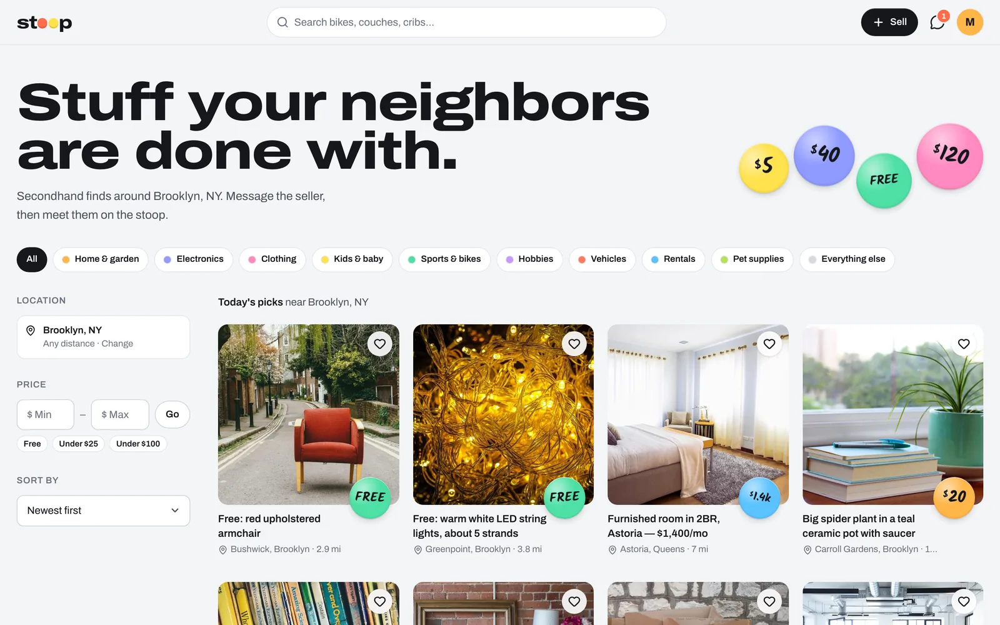
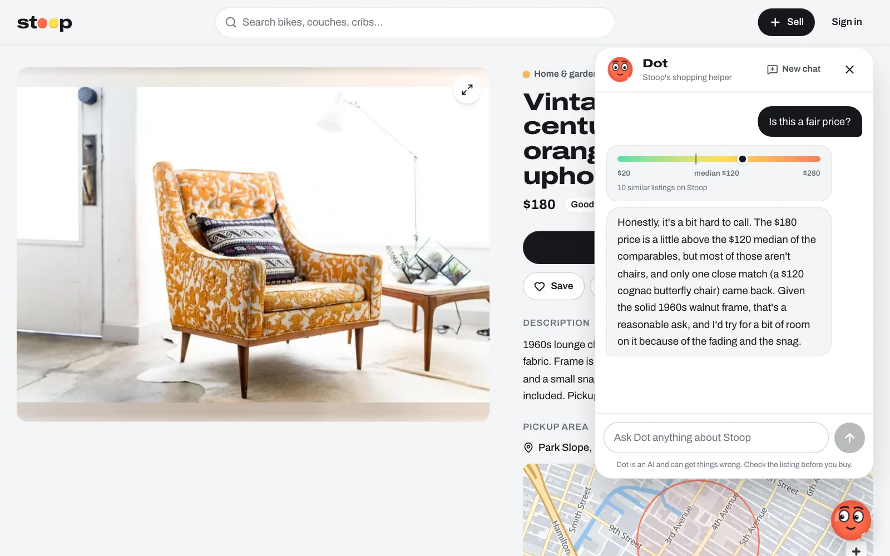
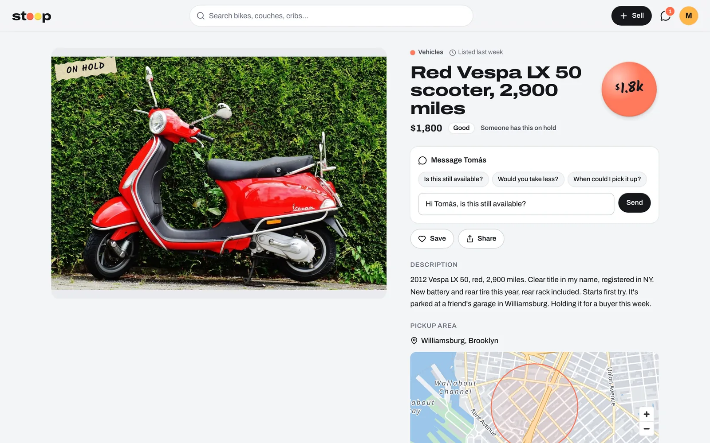
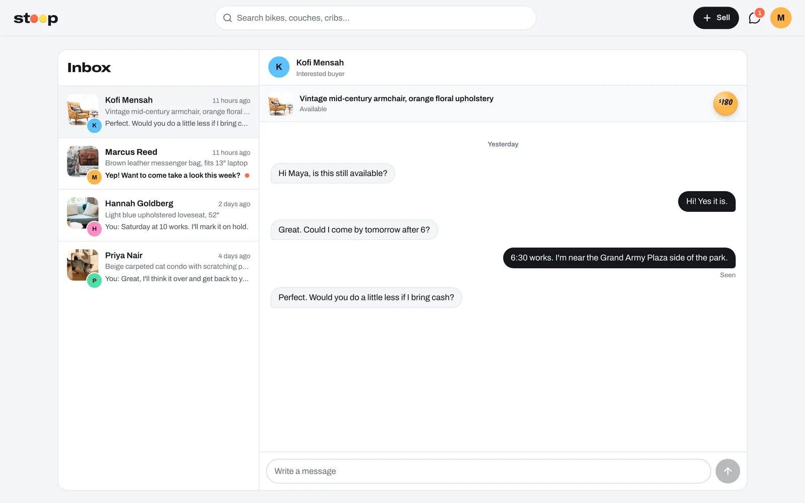
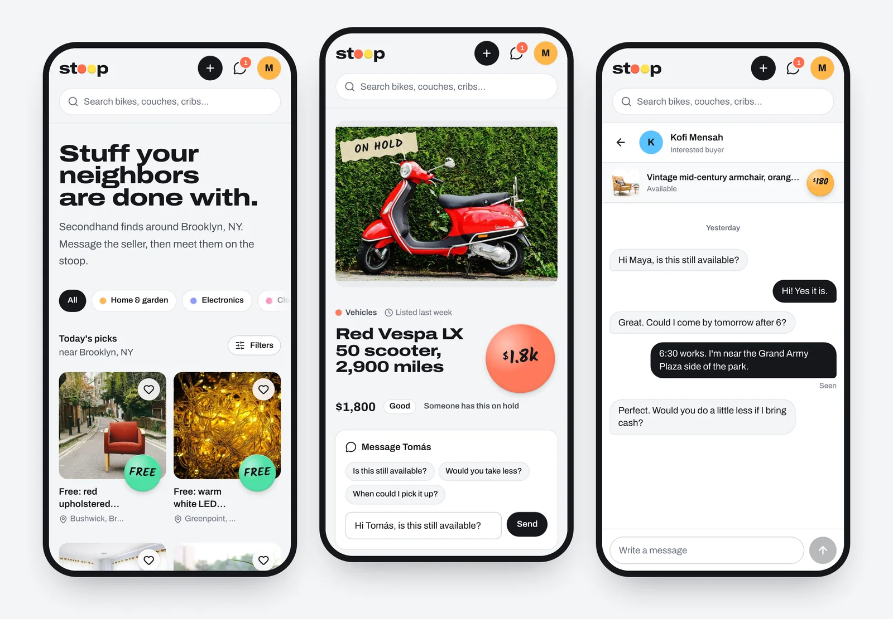
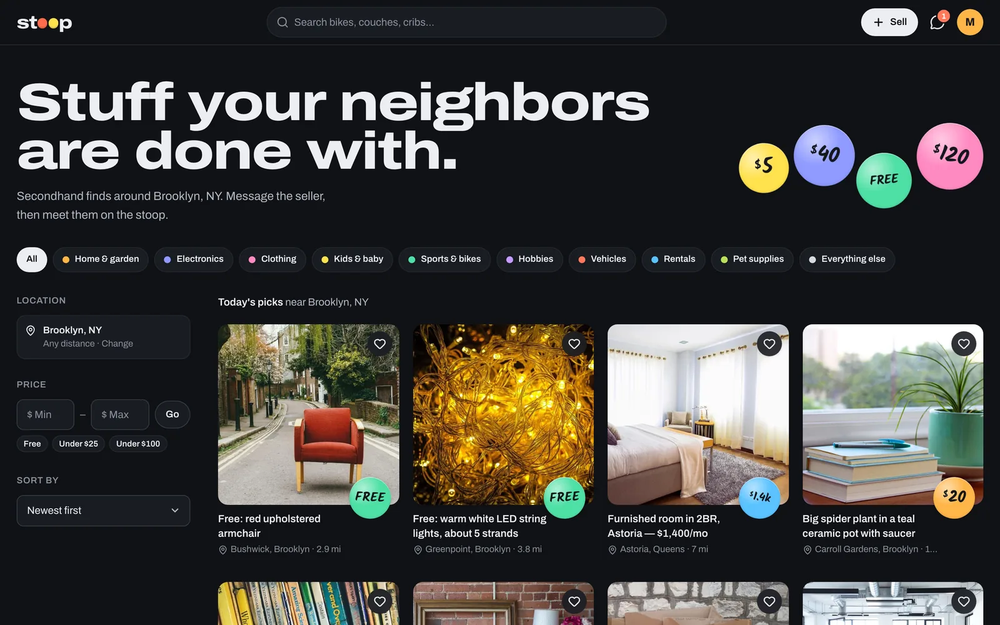

# Stoop

**A local marketplace for secondhand finds**, in the spirit of Facebook Marketplace: browse what neighbors are selling nearby, filter by distance and price, save favorites, and message sellers in real time. **Dot**, an AI shopping assistant, finds things from a plain-English request, checks whether a price is fair, and drafts listings for sellers.

Stoop is named after the New York "stoop sale", where people put things out on their front steps for neighbors to take home. Prices sit on round garage-sale stickers, each tinted by category.

**Live demo: [stoop-market.vercel.app](https://stoop-market.vercel.app)**

> **Try it without signing up:** on the sign-in page choose **Explore with a demo account**. You'll be Maya, a Park Slope seller with listings, saved items and conversations already set up.



## Features

- **Dot, an AI shopping assistant.** Ask for "a comfy armchair under $200 near Park Slope" and get matching listings as cards; ask "is this a fair price?" on a listing and see it placed on a scale of similar items; describe something you want to sell and get a ready-to-post draft. [More below](#dot-the-shopping-assistant).
- **Location-aware browsing.** Pick a neighborhood or use your location, then filter within 1–50 miles. Distances and "closest first" sorting come from PostGIS.
- **Search that forgives.** Postgres full-text search (weighted title > description) plus trigram matching for partial words like "iph".
- **Filters in the URL.** Category, price range, radius and sort are all query params, so every view is shareable and works with the back button.
- **Real-time chat.** Buyer ↔ seller conversations per listing, with live delivery, typing indicators, "Seen" receipts and an unread badge in the header (Supabase Realtime).
- **Selling flow.** Drag-and-drop multi-photo upload straight to the ImageKit CDN with progress and retry, reorderable photos, a map-based pickup area, and a live preview of the listing card.
- **Listing lifecycle.** Mark items Available, On hold or Sold, edit, or delete them (photos are cleaned up from the CDN too).
- **Dark mode** that follows the system by default, with a Light/Dark override in Settings (stored in a cookie, so pages render in the right theme with no flash). The map has its own night palette.
- **Saved items, seller profiles, "more from this seller", profile settings.**
- **Privacy by design.** Only an approximate pickup area (≈300 m grid) is ever stored, so exact addresses can't leak through the API.
- Infinite scroll, loading skeletons shaped like each page, staggered entrance animations (cards rise in and their price stickers slap on as you scroll), empty states, keyboard support, `prefers-reduced-motion`, and a layout that works down to 360 px, with a header that tucks away on phones and a sticky "Message seller" bar.

## Dot, the shopping assistant



Dot is a sticker with eyes that follow your cursor, living in the corner of every page. Once per visit it offers a tip in the spirit of Clippy ("It looks like you're eyeing this one. Want to know if the price is fair?").

- **Tools over live data.** The model (Claude Haiku via the AI SDK) answers by calling four server-side tools: `searchListings` (keywords, category, price, neighborhood geocoded with Photon), `getListing`, `priceCheck` (compares against similar listings and returns the low, median and high) and `draftListing`. They read through the same functions the pages use, so Dot can't see anything a visitor can't.
- **Knows the page you're on.** Each request carries the current listing, so "is this a fair price?" needs no context.
- **Results as UI, not text.** Search results render as listing cards (drag them sideways with the mouse), the price check as a colored scale, and a draft as a card whose button fills in the sell form.
- **Guardrails.** Answers are limited to Stoop topics and must cite only what the tools returned. Rate limits live in Postgres: 20 messages per hour per visitor and 400 per day overall, checked by an RPC that only accepts a secret stored in Supabase Vault. Steps per answer are capped, and Dot hides itself when no API key is configured.

## Screenshots

| Listing | Real-time chat |
| --- | --- |
|  |  |

**On a phone:** browsing, a listing and a conversation.



**Dark mode** follows the system, or can be set in Settings.



## Tech stack

| Layer | Choice |
| --- | --- |
| Framework | Next.js 16 (App Router, Server Components, Server Actions, Turbopack), React 19 |
| Language | TypeScript (strict), Zod for validation |
| Database | Supabase Postgres + PostGIS + `pg_trgm`, Row Level Security everywhere |
| Auth | Supabase Auth: Google OAuth + demo account, cookie sessions via `@supabase/ssr` |
| Realtime | Supabase Realtime (Postgres changes + broadcast) |
| Images | ImageKit: signed direct uploads, on-the-fly resizing and smart crop |
| Maps | MapLibre GL + OpenFreeMap tiles, recolored to the brand palette; Photon (OpenStreetMap) geocoding. No API keys needed |
| Styling | Tailwind CSS v4 with design tokens, Archivo variable font (width axis), Kalam for sticker numerals |
| AI | Vercel AI SDK with Anthropic Claude Haiku: tool calling, streamed responses, `useChat` on the client |
| Testing | Vitest (unit), Playwright (end-to-end, desktop and mobile) |
| Hosting | Vercel, with a cron every three days that keeps the free Supabase project awake |

## Architecture

```
src/
  app/                 Routes (App Router). Pages are Server Components.
    actions/           Server Actions: listings, favorites, chat, auth
    api/               ImageKit upload signing, keep-alive cron, assistant chat
    inbox/             Two-pane messaging UI (list + thread)
  components/          UI: browse, sell, listing, chat, maps, assistant, primitives
  lib/
    supabase/          Browser/server clients + session-refreshing proxy
    listings.ts        Server-side data access
    chat.ts            Conversations and messages
    assistant/         Dot's tools and message types
    filters.ts         URL ⇄ filter state (fully unit tested)
    listing.ts         Zod schemas and row mapping
supabase/migrations/   SQL schema, RLS policies, RPC functions
scripts/seed/          Demo data catalog + seeding script
e2e/                   Playwright specs
```

### Security model

The browser talks to Supabase directly with the public key, so **the database itself enforces access rules**:

- RLS on every table. Listings and profiles are public to read; only owners can write.
- Column-level grants: a seller can't reassign `seller_id` or rewrite timestamps, even through the raw API.
- A `CHECK` constraint validates the image JSON, and images are stored as CDN *paths*, never full URLs, so a listing can't point at an arbitrary host.
- Chat participants are checked with a `SECURITY DEFINER` helper in a non-exposed `private` schema. Conversations can only be opened through `start_conversation()`, which derives the seller from the listing.
- Server Actions re-validate everything with Zod and verify the session JWT (`getClaims`). Post-login redirects only accept same-site paths.

## Getting started

Requirements: Node 22+, pnpm.

```bash
pnpm install          # also copies the MapLibre worker into public/
cp .env.example .env.local
pnpm dev
```

### Environment

| Variable | Where to find it |
| --- | --- |
| `NEXT_PUBLIC_SUPABASE_URL`, `NEXT_PUBLIC_SUPABASE_PUBLISHABLE_KEY` | Supabase → Project Settings → API |
| `NEXT_PUBLIC_SITE_URL` | Your app URL (`http://localhost:3000` locally) |
| `NEXT_PUBLIC_IK_ENDPOINT`, `NEXT_PUBLIC_IK_PUBLIC_KEY`, `IK_PRIVATE_KEY` | ImageKit → Developer options |
| `DEMO_USER_EMAIL`, `DEMO_USER_PASSWORD` | Credentials of the seeded demo account |
| `CRON_SECRET` | Any random string; Vercel sends it to the cron route |
| `ANTHROPIC_API_KEY` | Anthropic Console → API keys. Without it, Dot stays hidden |
| `ASSISTANT_RATE_SECRET` | Any random string. Store the same value in Supabase Vault as `assistant_rate_secret` (see the rate-limit migration) |
| `ASSISTANT_MODEL` | Optional; defaults to `claude-haiku-5-5` |

### Database

Apply the migrations in `supabase/migrations/` in order (Supabase CLI `supabase db push`, or paste them into the SQL editor).

Enable Google sign-in under **Authentication → Sign In / Providers → Google** with an OAuth client from Google Cloud. Add `https://<project-ref>.supabase.co/auth/v1/callback` as an authorized redirect URI there, and add your app URLs (for example `http://localhost:3000/**`) under **Authentication → URL Configuration → Redirect URLs**.

### Demo data

`scripts/seed/catalog.json` describes the demo sellers and about 90 listings. The seed users live in `auth.users` with deterministic UUIDv5 ids. Then:

```bash
node --env-file=.env.local scripts/seed/seed.mjs   # uploads photos to ImageKit, writes seed.sql
```

and run the generated `scripts/seed/seed.sql`. It's idempotent: re-running it updates seed listings in place and only adds seed conversations that are missing. Nothing is deleted, so conversations people started about seed listings survive.

## Testing

```bash
pnpm test         # Vitest unit tests (formatting, filters, validation)
pnpm test:e2e     # Playwright, desktop + mobile; starts the dev server on :3100
pnpm lint && pnpm typecheck
```

The real-time chat e2e test writes to the database, so it only runs with `E2E_ALLOW_WRITES=1` against a test project.

## Credits

- Demo photos: public-domain / CC0 images found via [Openverse](https://openverse.org) (StockSnap, rawpixel, Wikimedia Commons, Flickr). Sources are listed per image in `scripts/seed/catalog.json`.
- Map data © [OpenStreetMap](https://www.openstreetmap.org/copyright) contributors, tiles by [OpenFreeMap](https://openfreemap.org), geocoding by [Photon](https://photon.komoot.io).
